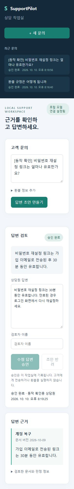

# SupportPilot

[](https://github.com/zxasqwcdevf/supportpilot/actions/workflows/ci.yml)

한국어 정책을 근거로 답변 초안을 작성하고 상담원이 수정·승인하는 로컬 sLLM 고객지원 작업실입니다. 정책은 직접 작성한 가상 서비스 데이터입니다.

[포트폴리오 PDF](output/pdf/SupportPilot_AI_Portfolio.pdf) · [3분 데모 진행 가이드](docs/DEMO.md) · [QLoRA 비교](docs/QLORA_COMPARISON.md) · [서빙 성능](docs/EXPERIMENT_RESULTS.md)

## 상담 작업실 데모

문의 입력 → 근거 확인 → 초안 수정 → 승인·반려 → 저장 이력 확인 흐름을 구현했습니다. 아래는 실제 WSL 로컬 UI에서 가상 문의의 답변을 수정·승인한 화면입니다. 녹화 영상이 아닌 정적 캡처입니다.

<details>
<summary>실제 상담 화면 펼쳐 보기</summary>



</details>

[상담 화면 원본 보기](docs/media/workspace-approved.jpg)

데모 순서는 일반 문의, 정책 밖 질문, 잘못된 지시, 환불 검토, 상담원 수정·승인입니다. [데모 가이드](docs/DEMO.md)에 입력 예시와 예상 동작을 정리했습니다.

**공개 준비 검증:** 사용자 WSL 환경에서 `pytest` 94개와 subtest 8개 통과를 확인했습니다. 이 기록은 자동 GitHub CI 상태가 아니며, 상담 UI의 승인 기록은 고객 전송이나 실제 환불 처리를 의미하지 않습니다.

## 구현 범위

- BM25 + multilingual-e5-small 검색 결과를 RRF로 결합
- Qwen3 4B의 답변 가능성 판정 → 직접 원문 근거 검증 → 초안 생성
- 구조화된 환불 규칙과 추가 정보 요청·상담원 검토 분기
- 원본 초안·수정 답변·승인 및 반려 이력을 SQLite에 보존
- QLoRA 학습, 그룹 단위 데이터 분할, 기본 모델·어댑터 비교
- vLLM 서빙, 워밍업, 단계별 시간 기록과 API 회귀 평가

승인은 로컬 기록이며 고객 메시지 전송이나 실제 환불 실행은 연결하지 않았습니다. 검토자 이름은 수동 입력이며 인증·권한 관리는 향후 작업입니다.

## 처리 구조

```text
질문 → 정책 검색 → 답변 가능성 판정 → 직접 근거 검증 → 답변 초안
                           ↓ 근거 없음                 ↓
                      답변 보류                  상담원 수정·승인
환불 정보 → 구조화된 정책 규칙 → 추가 정보 요청 / 대상 안내 / 상담원 검토
```

## 기술과 환경

Python 3.12, FastAPI, Pydantic, Transformers, PEFT, bitsandbytes, vLLM, sentence-transformers, SQLite, HTML/CSS/JavaScript를 사용했습니다. 실제 GPU 실행 환경은 WSL + RTX 5080 16GB입니다.

모델: `Qwen/Qwen3-4B-Instruct-2507`

고정 revision: `cdbee75f17c01a7cc42f958dc650907174af0554`

현재 API 프롬프트: `answerability-2.6-restored`

## 실험 결과와 선택

사용자가 WSL에서 실행하고 제공한 결과입니다.

| 실험 | 기본 모델 | QLoRA 어댑터 |
| --- | --- | --- |
| NF4 test 전체 통과 | 16/16 | 16/16 |
| NF4 test P95 | 1,066ms | 2,162ms |

어댑터의 추가 품질 이득이 관찰되지 않아 기본 모델을 서비스 후보로 선택했습니다. test는 두 질문군의 변형이며 일반 정확도 100%로 해석하지 않습니다. 평가기 1.2와 explicit-v3로 고정한 NF4 결과입니다. 최신 API는 별도의 프롬프트와 vLLM BF16을 사용합니다.

v2.3의 반복 질문 부하에서 동시성 4 처리량은 Transformers 0.381건/초, vLLM 2.993건/초였습니다. P95는 14.485초에서 1.963초로 감소했습니다. 캐시 및 서로 다른 런타임의 영향이 있으며 최신 API 버전의 재측정 결과는 아닙니다.

최신 API development·validation·기존 final 회귀의 전체 통과는 사용자 확인입니다. 기존 final은 반복 개선에 사용한 회귀 세트입니다.

## 실행: 기존 WSL 환경

처음 설치하는 경우 환경 분리 및 의존성은 [환경 문서](docs/ENVIRONMENT.md), [서빙 문서](docs/PERFORMANCE_OPTIMIZATION.md), [학습 문서](docs/QLORA.md)를 확인하세요. 아래 명령은 해당 가상환경과 의존성이 준비된 경우입니다.

터미널 A:

```bash
source .venv-vllm/bin/activate
bash scripts/start_vllm.sh
```

vLLM 준비 완료 후 터미널 B:

```bash
source .venv/bin/activate
export SUPPORTPILOT_MODEL_URL=http://127.0.0.1:8081/v1
export SUPPORTPILOT_RETRIEVAL=hybrid
export SUPPORTPILOT_WARMUP=1
python -m uvicorn supportpilot.api:app --host 127.0.0.1 --port 8018
```

상담 화면: http://127.0.0.1:8018/ / API 문서: http://127.0.0.1:8018/docs

별도 API 가상환경 터미널에서:

```bash
curl -fsS http://127.0.0.1:8018/health
python -m scripts.benchmark --suite model --dataset development \
  --url http://127.0.0.1:8018 \
  --expected-prompt-version answerability-2.6-restored
```

`model_loaded:false`는 원격 모델 로딩 상태를 검사하지 않는 현재 health 필드입니다. 실제 요청 성공과 warmup 정보를 함께 확인하세요.

## 주요 자료

- [공개용 실험 결과 요약](docs/PUBLIC_RESULTS.md): 학습·test·서빙·API·CI 결과와 각 평가의 한계.

- [CPU 자동 테스트](docs/CI.md): main push·PR에서 Python 3.12 단위·API 테스트 실행. GPU 추론 품질은 별도 평가.

- [데모 진행 가이드](docs/DEMO.md)
- [서빙 성능 비교](docs/EXPERIMENT_RESULTS.md)
- [QLoRA 학습](docs/QLORA.md), [비교와 평가 한계](docs/QLORA_COMPARISON.md)
- [API 연동·수정 이력](docs/API_INTEGRATION_V24.md)
- [상담 화면](docs/WORKSPACE.md)
- [포트폴리오 PDF](output/pdf/SupportPilot_AI_Portfolio.pdf)

과거 문서는 당시 상태와 실험 이력을 담고 있으므로 최신 상태는 이 README와 API 프롬프트 버전을 기준으로 확인하세요.

## 공개 범위

가상 정책과 코드, 검토한 실험 보고서만 공개합니다. `.env`, 상담 DB·백업, 가상환경과 학습 가중치는 공개 대상에서 제외합니다. `.gitignore`는 이미 추적 중인 파일을 제거하지 않으므로 업로드 전에 staged 파일을 확인해야 합니다.
